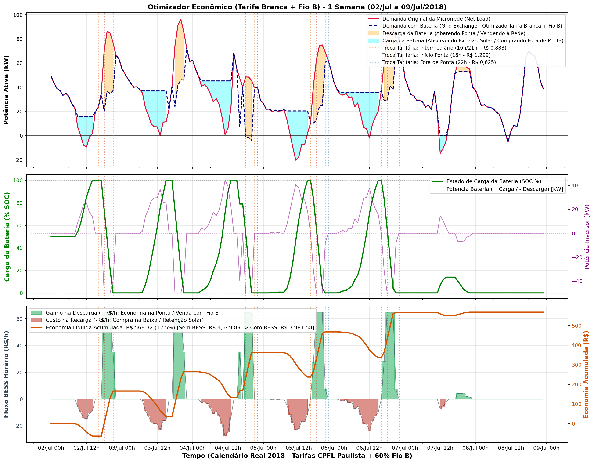
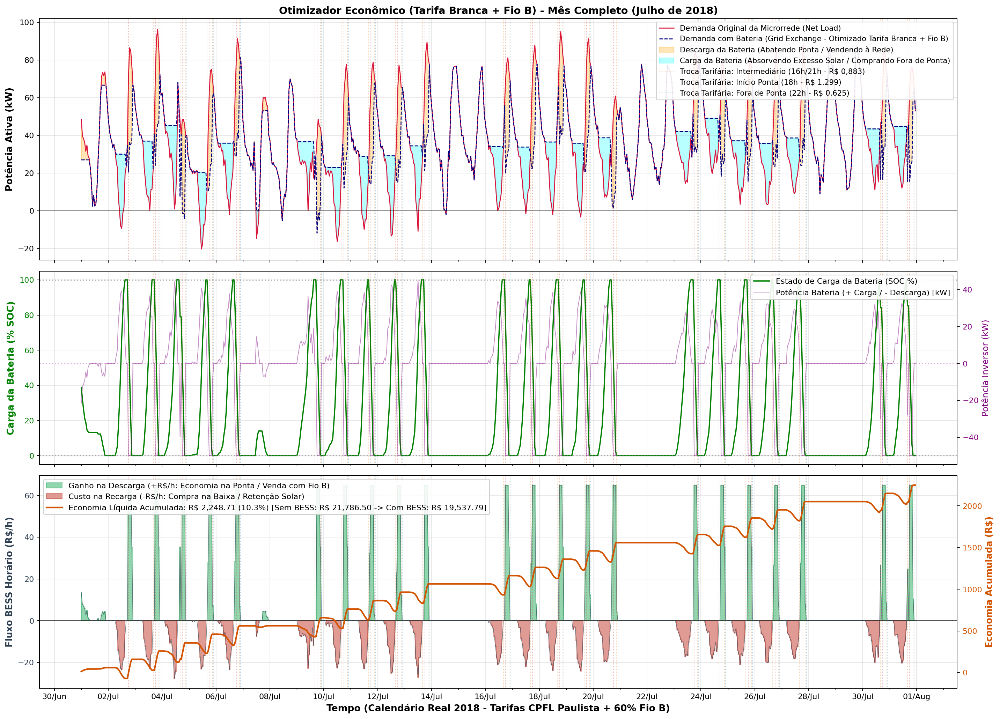
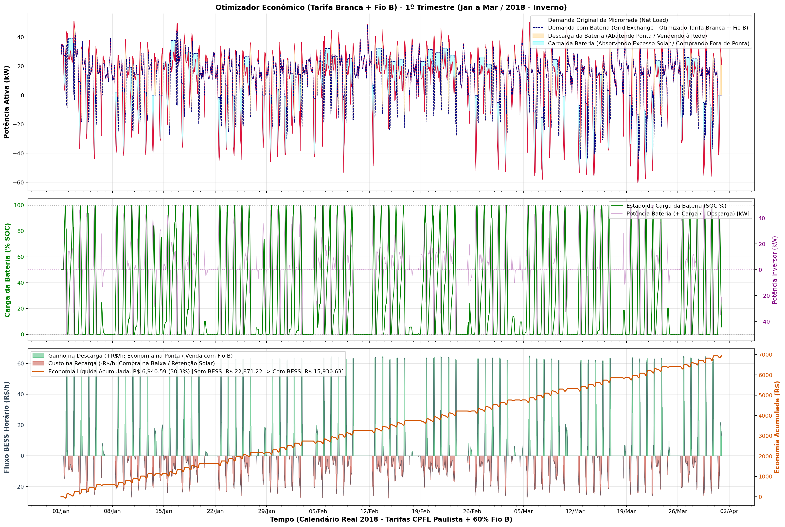
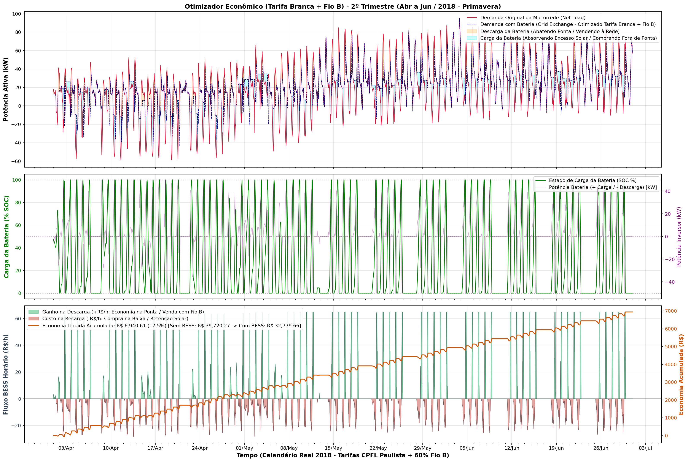
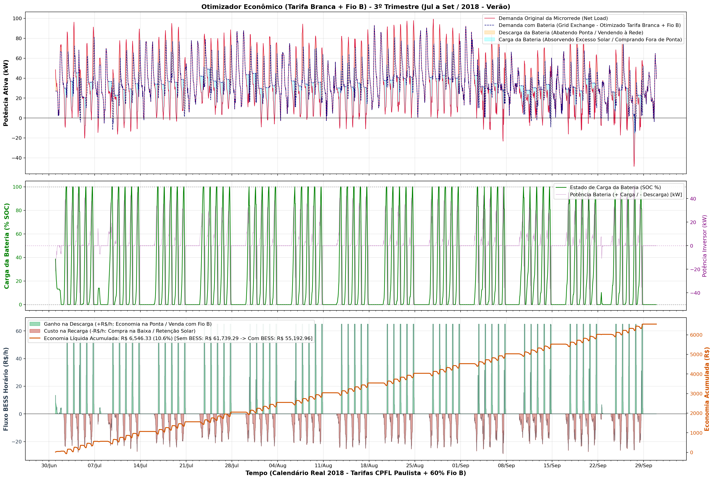
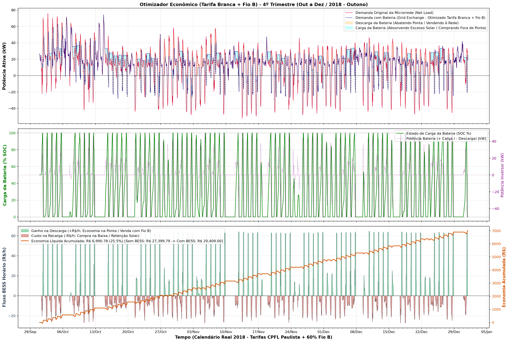

# Relatório Analítico e Interpretação dos Gráficos — Otimizador Econômico (Tarifa Branca + Fio B)

Este documento apresenta a explicação detalhada de cada um dos gráficos gerados pelo modelo de otimização econômico-financeira do Sistema de Armazenamento de Energia em Baterias (**BESS comunitário de $200\text{ kWh} / 50\text{ kW}$, eficiência $\eta = 95\%$**), operando em blocos diários de **24 horas iniciados estritamente às `00:00:00` (horário local do Texas — `America/Chicago`)**, sob as regras da **Tarifa Branca da CPFL Paulista** (Resolução Homologatória ANEEL nº 2.381/2018) e da **cobrança de $60\%$ do Fio B na exportação** (Lei Federal nº 14.300/2022 — ano-base 2026).

---

## 1. Guia de Leitura: Como Interpretar os Painéis Sincronizados

Cada figura é composta por **3 painéis horizontais sincronizados no tempo** (ou 4 painéis no gráfico comparativo de gastos acumulados), projetados para conectar a física da rede elétrica (potência e energia) ao resultado financeiro ($\text{R\$}$):

1. **Painel 1 (Superior) — Balanço de Potência no Medidor da Concessionária ($\text{kW}$):**
   - **Curva Vermelha Contínua (`Net Load`):** Demanda líquida original da comunidade ($\text{Carga} - \text{Geração Solar}$) caso não existisse bateria. Valores positivos ($\text{Net Load} > 0$) indicam necessidade de compra da rede; valores negativos ($\text{Net Load} < 0$) indicam excesso de geração solar sendo injetado na rede pública.
   - **Curva Azul Tracejada (`Grid Exchange`):** Demanda resultante vista pelo medidor da concessionária após a atuação da bateria ($\text{Net Load} + P_{\text{ch}} - P_{\text{dis}}$).
   - **Área Sombreada Ciano:** Momentos em que a bateria está **carregando** (absorvendo excesso solar que pagaria Fio B ou comprando energia mais barata no posto Fora de Ponta de forma perfeitamente nivelada — *Valley Filling*).
   - **Área Sombreada Laranja:** Momentos em que a bateria está **descarregando** (abatendo o consumo caro da comunidade na Ponta/Intermediário ou injetando excedente na rede).
   - **Linhas Verticais Pontilhadas (presentes nos gráficos de 1 Semana e 1 Mês):** Marcam exatamente as mudanças de preço da Tarifa Branca nos **Dias Úteis**:
     - **Pontilhada Laranja ($16\text{h}$ e $21\text{h}$):** Entrada no posto **Intermediário** ($\text{R\$ } 0,883/\text{kWh}$).
     - **Pontilhada Vermelha ($18\text{h}$):** Entrada no posto de **Ponta** ($\text{R\$ } 1,299/\text{kWh}$).
     - **Pontilhada Azul ($22\text{h}$):** Retorno ao posto **Fora de Ponta** ($\text{R\$ } 0,625/\text{kWh}$).

2. **Painel 2 (Intermediário) — Dinâmica Interna da Bateria ($\text{SOC \%}$ e $\text{kW}$):**
   - **Curva Verde (`SOC %` — Eixo Esquerdo):** Estado de carga da bateria de $0\%$ ($0\text{ kWh}$) a $100\%$ ($200\text{ kWh}$).
   - **Curva Roxa (`Potência do Inversor` — Eixo Direito):** Potência instantânea aplicada pelo conversor bidirecional ($+50\text{ kW}$ = carga máxima; $-50\text{ kW}$ = descarga máxima).

3. **Painel 3 (Inferior) — Balanço Monetário da Energia na Bateria ($\text{R\$/h}$ e $\text{R\$ Acumulado}$):**
   - **Áreas Vermelhas Negativas ($\text{Fluxo} < 0\text{ R\$/h}$ — Eixo Esquerdo):** Representam o **investimento financeiro na recarga** — isto é, o valor pago pela energia comprada da rede na Fora de Ponta ($\text{R\$ } 0,625/\text{kWh}$) ou o crédito de exportação solar temporariamente retido na bateria ($\text{R\$ } 0,517/\text{kWh}$, já descontado o Fio B de $\text{R\$ } 0,108/\text{kWh}$).
   - **Áreas Verdes Positivas ($\text{Fluxo} > 0\text{ R\$/h}$ — Eixo Esquerdo):** Representam o **retorno financeiro bruto na descarga**, quando a bateria evita a compra da tarifa cheia de Ponta ($\text{R\$ } 1,299/\text{kWh}$, gerando até $+\text{R\$ } 64,95/\text{h}$ a $50\text{ kW}$) ou vende energia excedente na Ponta ($\text{R\$ } 1,191/\text{kWh}$).
   - **Curva Laranja Contínua (`Economia Líquida Acumulada` — Eixo Direito):** Soma cumulativa do ganho líquido gerado pela bateria ($\text{Custo Sem BESS} - \text{Custo Com BESS}$) ao longo de todo o período simulado.

---

## 2. Análise Detalhada de Cada Gráfico e Conclusões Extraídas

### 2.1 Visão de Curto Prazo — 1 Semana (`02/Jul` a `09/Jul/2018`)

- **Métricas do Período:**
  - **Custo Sem Bateria:** $\text{R\$ } 4.549,89$ $\rightarrow$ **Custo Com Bateria:** $\text{R\$ } 3.981,58$
  - **Economia Líquida Gerada:** **$\text{R\$ } 568,32$ ($12,5\%$ de redução na fatura semanal)**
  - **Redução do Pico Semanal:** de $96,25\text{ kW}$ para $81,21\text{ kW}$ ($-15,6\%$)

- **O que podemos extrair deste gráfico:**
  1. **Recarga Uniforme (*Water-Filling*) na Fora de Ponta (`00h–15h`) e Sincronia com os Postos Tarifários:**
     - Graças ao envelope secundário dedicado à janela de Fora de Ponta ($P_{\text{max,fp}} - P_{\text{min,fp}}$ aliado ao teto de recarga $P_{\text{ch,peak}}$), o otimizador **elimina qualquer pico de recarga do inversor às $14\text{h–}15\text{h}$**.
     - Em todos os 5 dias úteis (`02/Jul` a `06/Jul`), a bateria preenche o vale da manhã e do início da tarde formando um **patamar perfeitamente plano e horizontal** na curva azul tracejada (`Grid Exchange` constante em $\sim 16\text{ kW}$ na segunda, $\sim 37\text{ kW}$ na terça, $\sim 45\text{ kW}$ na quarta, $\sim 20\text{ kW}$ na quinta e $\sim 36\text{ kW}$ na sexta).
     - A potência do inversor (curva roxa no Painel 2) sobe suavemente à medida que o sol aumenta (absorvendo o fundo do vale) e desacelera gradualmente entre $13\text{h}$ e $15\text{h}$ conforme a carga residencial começa a subir, atingindo **$100\%\text{ SoC}$ exatamente às $16\text{h}$ (primeira linha pontilhada laranja)**.
     - Exatamente às **$18\text{h}$ (linha vertical pontilhada vermelha — Início da Ponta)**, o inversor dispara para a descarga máxima ($-50\text{ kW}$), gerando os blocos verdes de **$+\text{R\$ } 64,95/\text{h}$** no 3º painel e derrubando drasticamente o pico de demanda até as **$22\text{h}$ (linha pontilhada azul)**, quando o SoC chega a $0\%$.
  2. **Venda Ativa para a Rede na Ponta (`04/Jul` — Quarta-Feira):**
     - No feriado norte-americano de 4 de julho (quarta-feira, dia útil no calendário tarifário), a demanda da comunidade às $18\text{h–}20\text{h}$ foi de apenas $\sim 45\text{ kW}$. Como o inversor descarrega $50\text{ kW}$, a curva azul tracejada (`Grid Exchange`) fica **negativa ($\approx -4\text{ kW}$) entre $19\text{h}$ e $20\text{h}$**: a bateria supre $100\%$ da comunidade (economizando $\text{R\$ } 1,299/\text{kWh}$) e ainda **vende a potência restante para a concessionária** na Ponta (recebendo $\text{R\$ } 1,191/\text{kWh}$ mesmo após descontar o Fio B!).
  3. **Comportamento nos Finais de Semana (`07/Jul` Sábado e `08/Jul` Domingo):**
     - Note a **ausência de linhas verticais pontilhadas** nos dois últimos dias do gráfico: no sábado e no domingo, a tarifa é fixa em Fora de Ponta ($\text{R\$ } 0,625/\text{kWh}$) durante as 24 horas.
     - Como comprar da rede a $\text{R\$ } 0,625/\text{kWh}$ para descarregar nos mesmos $\text{R\$ } 0,625/\text{kWh}$ geraria prejuízo financeiro devido aos $9,75\%$ de perdas térmicas de conversão ($\eta_{\text{ciclo}} = 0,95^2 = 90,25\%$), o otimizador econômico **não compra energia da rede no fim de semana**.
     - Em vez disso, ele atua exclusivamente como um **"captador de excesso solar"**: carrega apenas enquanto a curva vermelha está negativa ao meio-dia (chegando a $14\%\text{ SoC}$ no sábado e $3\%\text{ SoC}$ no domingo, evitando a multa do Fio B) e descarrega essa energia solar armazenada no pico das $17\text{h–}20\text{h}$, achatando o topo da curva de sábado de $60,3\text{ kW}$ para $53,0\text{ kW}$.

---

### 2.2 Visão Mensal Completa — Julho de 2018 (`grafico_tarifab_1mes.png`)

- **Métricas do Período:**
  - **Custo Sem Bateria:** $\text{R\$ } 21.786,50$ $\rightarrow$ **Custo Com Bateria:** $\text{R\$ } 19.537,79$
  - **Economia Líquida Gerada:** **$\text{R\$ } 2.248,71$ ($10,3\%$ de redução na conta mensal)**
  - **Redução do Pico Mensal:** de $96,25\text{ kW}$ para $87,68\text{ kW}$ ($-8,9\%$)

- **O que podemos extrair deste gráfico:**
  1. **Padrão de "Escada Semanal" na Curva de Economia Acumulada (Painel 3):**
     - A curva laranja de Economia Acumulada exibe **4 grandes degraus de subida** (correspondentes às 4 semanas úteis de julho: `02–06/Jul`, `09–13/Jul`, `16–20/Jul` e `23–27/Jul`), intercalados por **4 patamares horizontais planos** (`07–08/Jul`, `14–15/Jul`, `21–22/Jul` e `28–29/Jul`).
     - Isso comprova visualmente que, sob a Tarifa Branca brasileira, **mais de $95\%$ do retorno financeiro da bateria vem da arbitragem nos dias úteis**, enquanto os finais de semana contribuem apenas marginalmente (via isenção de Fio B sobre o excesso solar).
  2. **Nivelamento Consistente de Todos os Vales Diurnos do Mês:**
     - Em todos os 22 dias úteis de julho, as áreas sombreadas em ciano apresentam um topo perfeitamente plano entre $07\text{h}$ e $15\text{h}$, demonstrando que a formulação secundária de *Valley Filling* distribui a compra Fora de Ponta sem criar novos picos na rede.

---

### 2.3 Análise Sazonal Trimestral — Os 4 Trimestres de 2018 (365 Dias Alinhados às `00:00:00` do Texas)

#### A) 1º Trimestre: Janeiro a Março / 2018 — Inverno (`grafico_tarifab_trimestre1_jan_mar.png`)

- **Métricas do 1º Trimestre:**
  - **Custo Sem Bateria:** $\text{R\$ } 22.871,22$ $\rightarrow$ **Custo Com Bateria:** $\text{R\$ } 15.930,63$
  - **Economia Líquida Gerada:** **$\text{R\$ } 6.940,59$ ($30,3\%$ de redução — maior economia percentual do ano!)**
  - **Pico Original:** $51,04\text{ kW}$ $\rightarrow$ **Pico Com BESS:** $48,76\text{ kW}$
- **Conclusões do 1º Trimestre:**
  - No inverno, o consumo residencial é baixo e há **enorme geração solar excedente ao meio-dia** (picos negativos vermelhos chegando a $-60,5\text{ kW}$).
  - **Duplo Ganho (Fio B + Arbitragem de Ponta):** Sem a bateria, a comunidade injetaria essa energia solar ao meio-dia recebendo apenas $\text{R\$ } 0,517/\text{kWh}$ (perdendo $\text{R\$ } 0,108/\text{kWh}$ de Fio B) e teria de recomprar energia à noite pagando $\text{R\$ } 1,299/\text{kWh}$ (uma perda de valor de $60\%$!). Com a bateria, o excesso solar é absorvido gratuitamente *Behind-the-Meter* e descarregado na Ponta, abatendo quase um terço ($30,3\%$) de toda a conta de energia do trimestre.

---

#### B) 2º Trimestre: Abril a Junho / 2018 — Primavera (`grafico_tarifab_trimestre2_abr_jun.png`)

- **Métricas do 2º Trimestre:**
  - **Custo Sem Bateria:** $\text{R\$ } 39.720,27$ $\rightarrow$ **Custo Com Bateria:** $\text{R\$ } 32.779,66$
  - **Economia Líquida Gerada:** **$\text{R\$ } 6.940,61$ ($17,5\%$ de redução)**
  - **Pico Original:** $94,94\text{ kW}$ $\rightarrow$ **Pico Com BESS:** $94,94\text{ kW}$
- **Conclusões do 2º Trimestre:**
  - O gráfico divide-se nitidamente em dois regimes climáticos:
    1. **Abril a meados de Maio:** Forte presença de excedente solar negativo (`Net Load < 0`); a bateria carrega quase $100\%$ com sol excedente e até exporta sobra na Ponta.
    2. **Final de Maio e Junho:** A chegada do calor eleva a carga para $>80\text{ kW}$ e elimina o excedente solar. O otimizador muda automaticamente de estratégia: passa a comprar energia da rede na Fora de Ponta ($\text{R\$ } 0,625/\text{kWh}$) de forma nivelada para descarregar na Ponta ($\text{R\$ } 1,299/\text{kWh}$).
  - Mesmo com a mudança radical de clima, a **economia financeira trimestral permanece extremamente estável ($\sim \text{R\$ } 6.941$)**, pois um ciclo diário completo de $200\text{ kWh}$ deslocado para a Ponta gera praticamente o mesmo ganho bruto diário ($\sim \text{R\$ } 110\text{ a R\$ } 125/\text{dia útil}$).

---

#### C) 3º Trimestre: Julho a Setembro / 2018 — Verão (`grafico_tarifab_trimestre3_jul_set.png`)

- **Métricas do 3º Trimestre:**
  - **Custo Sem Bateria:** $\text{R\$ } 61.739,29$ $\rightarrow$ **Custo Com Bateria:** $\text{R\$ } 55.192,96$
  - **Economia Líquida Gerada:** **$\text{R\$ } 6.546,33$ ($10,6\%$ de redução)**
  - **Pico Original:** $99,21\text{ kW}$ $\rightarrow$ **Pico Com BESS:** $93,12\text{ kW}$
- **Conclusões do 3º Trimestre:**
  - É o trimestre de maior consumo energético do ano (fatura base de $\text{R\$ } 61,7\text{ mil}$). Como quase toda a geração solar é consumida instantaneamente pelos aparelhos de ar-condicionado da própria comunidade (*autoconsumo natural*), sobra pouco excesso solar em julho e agosto.
  - Por isso, no verão a bateria precisa comprar energia da rede a $\text{R\$ } 0,625/\text{kWh}$ (em vez de usar excesso solar que custaria $\text{R\$ } 0,517/\text{kWh}$ em crédito de exportação), o que explica por que a economia trimestral ($\text{R\$ } 6.546,33$) é cerca de $\text{R\$ } 400$ menor que nos outros trimestres.

---

#### D) 4º Trimestre: Outubro a Dezembro / 2018 — Outono (`grafico_tarifab_trimestre4_out_dez.png`)

- **Métricas do 4º Trimestre:**
  - **Custo Sem Bateria:** $\text{R\$ } 27.399,79$ $\rightarrow$ **Custo Com Bateria:** $\text{R\$ } 20.409,00$
  - **Economia Líquida Gerada:** **$\text{R\$ } 6.990,78$ ($25,5\%$ de redução — maior economia absoluta em R\$ do ano!)**
  - **Pico Original:** $75,93\text{ kW}$ $\rightarrow$ **Pico Com BESS:** $74,22\text{ kW}$
- **Conclusões do 4º Trimestre:**
  - A partir de meados de outubro, a queda da temperatura reduz o consumo de ar-condicionado e devolve à microrrede expressivos excedentes solares diurnos ($\text{Net Load}$ chegando a $-51,9\text{ kW}$).
  - A bateria volta a operar no **regime ótimo de dupla captura de valor**: evita a cobrança de $60\%$ do Fio B ao absorver a geração solar ao meio-dia e abate integralmente os picos residenciais das $18\text{h–}21\text{h}$, alcançando a maior economia financeira absoluta do ano (**$\text{R\$ } 6.990,78$**).

---

## 3. Quadro-Síntese Anual e Principais Achados para o TCC

| Horizonte Simulado | Custo Sem BESS ($\text{R\$}$) | Custo Com BESS ($\text{R\$}$) | Economia Gerada ($\text{R\$}$) | Economia (%) | Pico Original ($\text{kW}$) | Pico Com BESS ($\text{kW}$) | Arquivo de Gráfico |
| :--- | :---: | :---: | :---: | :---: | :---: | :---: | :--- |
| **1 Semana (02/Jul a 09/Jul)** | $\text{R\$ } 4.549,89$ | $\text{R\$ } 3.981,58$ | **$\text{R\$ } 568,32$** | **$12,5\%$** | $96,25$ | $81,21$ | `grafico_tarifab_1semana.png` |
| **1 Mês (Julho/2018)** | $\text{R\$ } 21.786,50$ | $\text{R\$ } 19.537,79$ | **$\text{R\$ } 2.248,71$** | **$10,3\%$** | $96,25$ | $87,68$ | `grafico_tarifab_1mes.png` |
| **1º Trimestre (Inverno)** | $\text{R\$ } 22.871,22$ | $\text{R\$ } 15.930,63$ | **$\text{R\$ } 6.940,59$** | **$30,3\%$** | $51,04$ | $48,76$ | `grafico_tarifab_trimestre1_jan_mar.png` |
| **2º Trimestre (Primavera)** | $\text{R\$ } 39.720,27$ | $\text{R\$ } 32.779,66$ | **$\text{R\$ } 6.940,61$** | **$17,5\%$** | $94,94$ | $94,94$ | `grafico_tarifab_trimestre2_abr_jun.png` |
| **3º Trimestre (Verão)** | $\text{R\$ } 61.739,29$ | $\text{R\$ } 55.192,96$ | **$\text{R\$ } 6.546,33$** | **$10,6\%$** | $99,21$ | $93,12$ | `grafico_tarifab_trimestre3_jul_set.png` |
| **4º Trimestre (Outono)** | $\text{R\$ } 27.399,79$ | $\text{R\$ } 20.409,00$ | **$\text{R\$ } 6.990,78$** | **$25,5\%$** | $75,93$ | $74,22$ | `grafico_tarifab_trimestre4_out_dez.png` |
| **Total Anual (2018 Completo)** | **$\text{R\$ } 151.730,56$** | **$\text{R\$ } 124.312,25$** | **$\text{R\$ } 27.418,31$** | **$18,1\%$** | — | — | — |

### 4 Conclusões-Chave que estes Gráficos Comprovam para a Monografia:

1. **Estabilidade da Receita da Bateria ao Longo das Estações ($\sim \text{R\$ } 6.546\text{ a R\$ } 6.991/\text{trimestre}$):**
   Mesmo com o consumo da microrrede triplicando entre o inverno e o verão, a economia gerada pelo BESS permanece notavelmente constante em todos os trimestres (somando **$\text{R\$ } 27.418,31/\text{ano}$**), pois o ganho é determinado pela capacidade da bateria ($200\text{ kWh}$) multiplicada pelo *spread* tarifário diário entre Fora de Ponta/Excesso Solar e Ponta.
2. **Importância do Envelope Secundário de Fora de Ponta ($P_{\text{max,fp}} - P_{\text{min,fp}}$ + $P_{\text{ch,peak}}$):**
   Ao separar o envelope de nivelamento da janela de recarga Fora de Ponta (`00h–15h`) em relação ao envelope global de 24h, a bateria realiza um *water-filling* horizontal perfeito durante toda a manhã e início da tarde, evitando saltos bruscos do inversor às $14\text{h–}15\text{h}$ antes da entrada da tarifa Intermediária.
3. **Sinergia entre Lei 14.300 (Fio B) e Tarifa Branca:**
   Nos meses de outono, inverno e primavera, o Fio B torna a exportação solar direta desvantajosa ($\text{R\$ } 0,517/\text{kWh}$ contra $\text{R\$ } 1,299/\text{kWh}$ na Ponta). O BESS elimina essa perda mantendo a energia *Behind-the-Meter* (atrás do medidor).
4. **Inatividade de Arbitragem nos Finais de Semana:**
   Como a Tarifa Branca possui valor único ($\text{R\$ } 0,625/\text{kWh}$) aos sábados e domingos e o ciclo da bateria possui $9,75\%$ de perdas térmicas ($\eta^2 = 90,25\%$), o otimizador econômico prova que **não vale a pena ciclar a bateria com energia da rede nos finais de semana**, devendo-se apenas armazenar o excesso solar puro.
